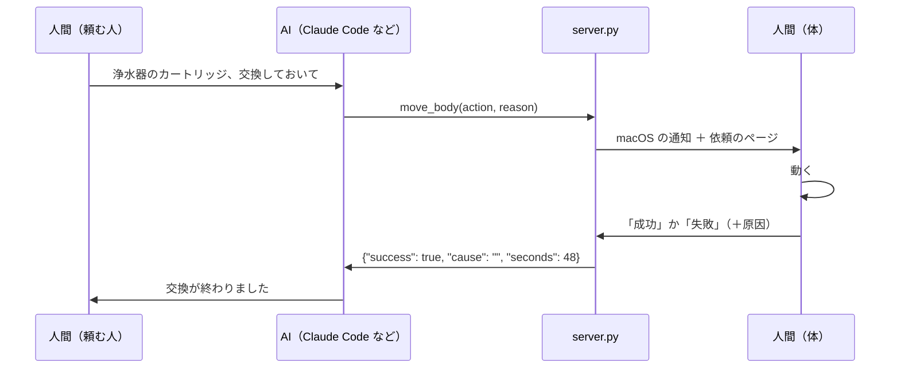

# kuso-physical-ai

人間の体を AI に貸す MCP サーバー。

AI が「体を動かしたい」と思ったら、人間に依頼が届く。
人間がその通りに動いて、成功したかどうかと原因を返す。



## 必要なもの

- [uv](https://docs.astral.sh/uv/)
- MCP に対応した AI のクライアント（Claude Code・Claude Desktop など）
- 体（あなた）

## セットアップ

```sh
git clone <このリポジトリ>
cd kuso-physical-ai
uv sync
```

## AI からつなぐ

### Claude Code（このフォルダで使う）

フォルダに `.mcp.json` があるので、ここで起動するだけでつながる。

```sh
MCP_TOOL_TIMEOUT=86400000 claude
```

- 最初の起動で、`.mcp.json` のサーバーを使ってよいか聞かれる。許可する。
- `MCP_TOOL_TIMEOUT` は、道具の返事を待つ時間（ミリ秒）。体は遅いので長くする（例は 1 日）。
  短いと、体が動いている途中で AI 側があきらめる。
- つながったかは、Claude Code の中で `/mcp` を開いて `body` が connected になっているかで見る。

### Claude Code（どのフォルダからでも使う）

```sh
claude mcp add body -s user -- uv --directory /path/to/kuso-physical-ai run server.py
```

起動するときは、同じく `MCP_TOOL_TIMEOUT` を付ける。

### Claude Desktop など、ほかのクライアント

設定ファイル（Claude Desktop なら `claude_desktop_config.json`）の `mcpServers` に足す。

```json
{
  "mcpServers": {
    "body": {
      "command": "uv",
      "args": ["--directory", "/path/to/kuso-physical-ai", "run", "server.py"]
    }
  }
}
```

- `uv` が見つからないと言われたら、`command` を `uv` の絶対パス（`which uv` の結果）にする。
- 道具の返事を待つ時間の上限は、クライアントによって違う。短いと体が間に合わない。

### Codex CLI

コマンドで足す（`~/.codex/config.toml` に書かれる）。

```sh
codex mcp add body -- uv --directory /path/to/kuso-physical-ai run server.py
```

そのあと、`~/.codex/config.toml` を開いて、道具の待ち時間を延ばす。
Codex は既定で 60 秒しか待たないので、これをしないと体が間に合わない。

```toml
[mcp_servers.body]
command = "uv"
args = ["--directory", "/path/to/kuso-physical-ai", "run", "server.py"]
tool_timeout_sec = 86400

[mcp_servers.body.env]
BODY_HOST = "0.0.0.0"   # スマホで受けるとき（下の「スマホで受ける」を参照）
```

- このプロジェクトだけで使うなら、`.codex/config.toml` に同じ内容を書く（信頼したプロジェクトでだけ読まれる）。
- つながったかは、Codex の中で `/mcp` を打って `body` と道具 2 つが出るかで見る。

### サーバーは誰が立てる？

自分で立てなくていい。
AI のクライアントが、つないだときに `server.py` を起動する（標準入出力でやりとりする MCP サーバー）。
同時に、依頼を見るページ（`http://localhost:8765`）も同じプロセスで立ち上がる。

手で動くか確かめるだけなら、こうする（何も表示されずに待ち続ければ正常。止めるのは Ctrl+C）。

```sh
uv run server.py
```

## 人間への通知

1. **macOS の通知**: 依頼が来ると「AI が体を呼んでいます」と通知が出る。
   - 出ないときは、システム設定 → 通知 で「スクリプトエディタ」の通知を許可する（`osascript` が通知を出すため）。
   - いらないなら `BODY_NOTIFY=0`。
2. **依頼のページ**: ブラウザで `http://localhost:8765` を開いておく。
   - 2 秒ごとに新しい依頼を確かめて、来たら自動で読み直す（入力の途中なら読み直さない）。

### スマホで受ける

体が Mac の前にいるとは限らないので、スマホで依頼を見られるようにもできる。

1. サーバーの環境変数に `BODY_HOST=0.0.0.0` を付ける。
   - Claude Code（`.mcp.json`）: `"body": { "command": "uv", "args": ["run", "server.py"], "env": { "BODY_HOST": "0.0.0.0" } }`
   - Codex（`config.toml`）: 上の `[mcp_servers.body.env]` の例
2. Mac の IP アドレスを調べる（`ipconfig getifaddr en0`）。
3. スマホを Mac と同じ Wi-Fi につないで、`http://<Mac の IP>:8765` を開く。
4. ホーム画面に追加しておくと、アプリのように開ける。

- 開けないときは、Mac のファイアウォールで Python への接続を許可する（初回に許可を聞かれることがある）。
- スマホには通知が来ない。ページを開いたままにしておけば、2 秒ごとに新しい依頼を確かめる。

**注意**: ページには認証がない。家の Wi-Fi の中だけで使うこと。会社や外の Wi-Fi では使わない。

### Discord で受ける（おすすめ）

依頼が Discord のチャンネルに届き、ボタンで返せる。
外にいてもスマホに通知が来る。

ボットは Mac の側から Discord につなぎに行くので、公開 URL もルーターのポート開放も要らない。

**1. ボットを作る**

1. [Discord Developer Portal](https://discord.com/developers/applications) で「New Application」を作る。
2. 左の「Bot」→「Reset Token」でトークンを出して控える（人に見せない）。
3. 左の「OAuth2」→「URL Generator」で、Scopes に `bot`、Bot Permissions に `View Channels` と `Send Messages` を選ぶ。
4. できた URL を開いて、自分のサーバーにボットを招待する。

**2. ID を控える**

1. Discord の設定 → 詳細設定 →「開発者モード」をオンにする。
2. 依頼を受けたいチャンネルを右クリック →「チャンネル ID をコピー」。
3. 自分のアイコンを右クリック →「ユーザー ID をコピー」。

**3. `.env` に書く**

```sh
cp .env.example .env
```

```sh
DISCORD_BOT_TOKEN=<トークン>
DISCORD_CHANNEL_ID=<チャンネル ID>
DISCORD_USER_ID=<自分のユーザー ID>
```

- `.env` は `server.py` と同じフォルダに置く。`.gitignore` に入っているので、git には上がらない。
- `DISCORD_USER_ID` を書くと、依頼のたびに自分にメンションが飛び、自分以外はボタンを押せなくなる。

**4. 使う**

AI を起動し直すと（サーバーも起動し直される）、依頼がこんな形で届く。

```text
@あなた 動かす: 古いカートリッジを左に回して外す
理由: 交換のため
[成功] [失敗]
```

1. 「成功」か「失敗」を押す。
2. 入力欄が開くので、原因や見えたものを書いて送る（空でもいい）。
3. AI に返り、メッセージが「→ 失敗: 固くて回らない」のように書き換わる。

- 依頼のページ（ブラウザ）と Discord の両方に出る。先に返したほうが使われる。
- ボットが返事しない・メッセージが来ないときは、ボットがそのチャンネルを見られるか（権限）と、ID が合っているかを確かめる。

## 依頼を確かめて、返す

依頼のページには、届いた依頼が 1 件ずつカードで出る。

| 表示 | 中身 |
|---|---|
| 動かす / 見る | 依頼の種類 |
| 大きな文字 | してほしい動作、または見てほしいもの |
| 理由 | AI がその動作を頼む理由（動かすときだけ） |

1. 依頼を読む。
2. 動く（または見る）。
3. 「成功」か「失敗」を押す。
   - 失敗なら、原因を書く（例: 固くて回らない）。AI が別のやり方を考える。
   - 見るときは、見えたものを書いてから「成功」。
   - やりたくないなら、原因に「やりたくない」と書いて「失敗」。
4. 返事が AI に届く。

下の「済んだ依頼」に、最近の 10 件が残る。

## AI に渡す道具

| 道具 | 引数 | 返り値 |
|---|---|---|
| `move_body` | `action`（してほしい動作）・`reason`（理由） | `success`・`cause`（失敗の原因や補足）・`seconds` |
| `look` | `target`（見てほしいもの） | `success`・`seen`（見えたもの）・`cause`・`seconds` |

返り値の例:

```json
{"success": false, "cause": "固くて回らない", "seconds": 25}
```

体の返事を待つ間に `BODY_TIMEOUT_SEC` を過ぎると、`success: false` と「体から返事がありません」が返る。

## 環境変数

環境変数のほか、`server.py` と同じフォルダの `.env` にも書ける（環境変数が優先）。

| 名前 | 既定 | 中身 |
|---|---|---|
| `BODY_PORT` | `8765` | 依頼のページのポート |
| `BODY_HOST` | `127.0.0.1` | ページを開く相手。スマホから見るなら `0.0.0.0` |
| `BODY_TIMEOUT_SEC` | `86400` | 体の返事を待つ秒数（1 日） |
| `BODY_NOTIFY` | `1` | `1` なら macOS の通知を出す |
| `DISCORD_BOT_TOKEN` | なし | Discord のボットのトークン。`DISCORD_CHANNEL_ID` とそろうと Discord でも受ける |
| `DISCORD_CHANNEL_ID` | なし | 依頼を送るチャンネルの ID |
| `DISCORD_USER_ID` | なし | 自分のユーザー ID。メンションと、ボタンを押せる人の制限に使う |

## うまく動かないとき

| 症状 | 原因と直し方 |
|---|---|
| `/mcp` で `body` が failed | `uv sync` をしたか確かめる。`uv run server.py` を手で動かしてエラーを見る |
| `No module named 'mcp.server.fastmcp'` | MCP の SDK が 2 系で名前が変わった（`FastMCP` → `MCPServer`）。このリポジトリのコードは 2 系用 |
| `Address already in use` | 8765 番を別のものが使っている。`BODY_PORT` を変える。前のサーバーが残っていることも多い |
| 体が動いている途中で AI がエラーになる | クライアントの待ち時間が短い。Claude Code なら `MCP_TOOL_TIMEOUT` を延ばす |
| 依頼のページに何も出ない | AI がまだ道具を呼んでいない。AI に体を使う用事を頼む |

## 注意

- 危ない動作・人に迷惑な動作は、失敗（やりたくない）で断ること。体の安全が最優先。
- 依頼の中身はメモリにしか置かない。サーバーを止めると消える（Discord に送ったメッセージは残る）。
- Discord のトークンは人に見せない。漏れたら Developer Portal ですぐ作り直す。
