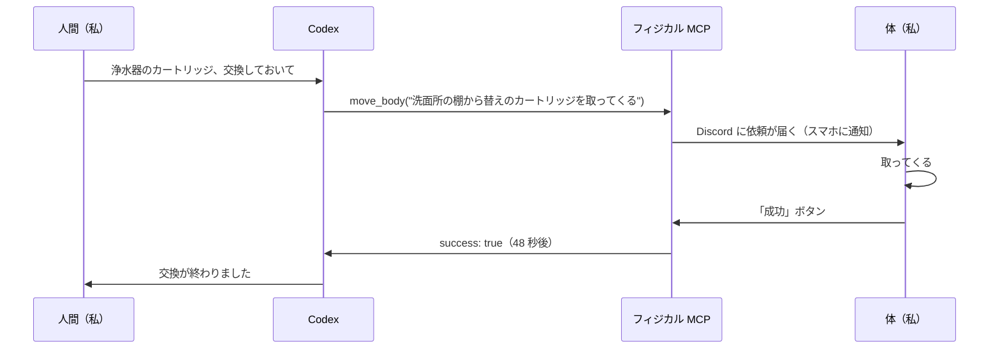

# クソフィジカルAI を求めて

この記事は クソアプリ Advent Calendar 2026 の 1日目 の記事です。

https://qiita.com/advent-calendar/2026/kuso-app

## AI に生活を管理してもらっています

こんにちは某猫です。

皆さん、AI に何を任せていますか？

コーディング？ 調べもの？ 壁打ち？

私はコーディングだけでなく、日々のスケジュールや掃除用品の置き場所、体調、所持している持ち物など、生活のほとんどすべてを AI に管理してもらっています。

AIサービスが提供しているメモリ機能だけではなく、
パーソナルナレッジベースを組んでおいて、いつでもモデル等々は切り替えられるようにしています。

「私の家についてる浄水器っていつ替えたっけ？」と聞けば答えが返ってくる感じですね。

しかも定期ジョブ的なものも動かしているので、期限が近くなるとあちらから教えてくれます。

「浄水器のカートリッジの交換時期です。予備は洗面所の棚の上段にしまってあるので、それと交換してください」

みたいな感じで、予備の置き場所まで添えてくれるんで、かなり便利ですね。皆さんも生活のすべてを AI に任せましょう。

ただ！

私は思うわけです

**「そこまでわかっているなら、もうやっておいてよ！」** と

まぁ彼らは体を持っていないので当然なんですが、、、

## そうだ、フィジカルをプレゼントしよう

ここ数年ずっと AI AI 言われていますが、今年はフィジカル AI がより伸びた年ではないでしょうか？

8月に北京で開かれた人型ロボットの運動会（世界人型ロボット運動会）は、2 回目にして規模がすごいことになっていました。

- 16 カ国から 666 チーム、ロボット 2,056 台
- 去年は 280 チーム・500 台くらいだったので、台数は 1 年で約 4 倍
- 100m 走で 9.39 秒が出た、という報道まである

ボルトより速いってやばすぎないですか？

日本でも、次の学習指導要領の素案に「フィジカル AI」という言葉が入ったらしいです[^1]

で、思うじゃないですか

うちの AI にもフィジカルをあげれば、面倒臭い浄水器の交換までやってくれるのでは？？

というわけで、今年勢いのあったフィジカルをプレゼントして、うちの AI をフィジカル AI[^2] に進化させてあげようと思います！！

## でもロボットは高い

とりあえず人型ロボットの値段を調べてみたのですが、

https://www.1x.tech/order

高え、、、クソアプリのために出せる金額ではないですね(いや、安いとは思うけどね)

もっとこう、安くて、すでに家にあって、そこそこ器用に動く体はないものか……

<!-- スクリーンショット差し込み位置（image1） -->
**あ、ありました。私の体です**

というわけで私の体を AI に貸していきましょう

## 作ったもの

AI が「体を動かしたいな〜」と思ったら私に依頼が飛んできて、私がその通りに動いて、成功したかどうかを返す、という仕組みです。



うーん、、、、、、

**頼んだのも私、動くのも私だなぁ**

AI は間に入って、私の体の動かし方を私に指示しているだけなんですよね。

いや人間がやるんかい、という感じですが、体を持っているのが私しかいないので仕方ないですね。

<!-- TODO: Discord に届いた依頼のスクリーンショットを入れる -->

## 仕様

AI に渡す道具は 2 つだけにしました。

| 道具 | できること | 備考 |
|---|---|---|
| `move_body(action, reason)` | 体を動かす | 1 回に小さな動作 1 つだけ。理由は必須 |
| `look(target)` | 目で見る | カメラではなく、私が見て文章で答える |

目はカメラをつなぐのが面倒だったので、私が見て文章で答える方式です。解像度は私のやる気しだいですね。

道具が呼ばれると、こんな流れになります。

1. Discord のチャンネルに依頼が届く（スマホに通知が来る）
2. 私が依頼を見る
3. 私が動く
4. 「成功」か「失敗」のボタンを押す（失敗なら原因も書く）
5. それが AI に返って、メッセージが結果に書き換わる

外にいてもスマホに依頼が飛んでくるので、どこにいても AI の体として呼び出されます。逃げ場がないですね。

（Discord を使わない人向けに、ブラウザで見る依頼のページも用意しています）

AI に返るのはこの 3 つです。

| 項目 | 中身 |
|---|---|
| `success` | 成功したかどうか（true / false） |
| `cause` | 失敗の原因。自然言語で書く |
| `seconds` | 体が動くのにかかった秒数 |

原因を返すようにしたのは、AI が次の手を考えられるようにするためです。「固くて回らない」と返せば、別のやり方を出してくれるはず。

ちなみに体にも人権があるので、原因に「やりたくない」と書いて失敗にすれば断れます。

あと、体の返事を待つ時間は最大 1 日にしました。AI に「右手を上げて」と言われてから昼寝をして、起きてから上げても間に合うのでありがたいですね。

## 作成！

### 構成

ここから実装の話です。

といっても MCP サーバーを 1 つ書いただけで、Python 230 行くらい、依存は MCP の SDK と discord.py だけです。

AI とは標準入出力（stdio）で話して、人間とは Discord（とブラウザ）で話す、という 2 つの口を持っている感じですね。

Discord のボットは Mac の側から Discord につなぎに行く方式（Gateway）なので、公開 URL もポート開放も要らないのが良いところです。ローカルで動かすだけなら Webhook で受けるより断然楽でした。

### 道具の部分

```python
@mcp.tool()
async def move_body(action: str, reason: str) -> dict:
    """人間の体を動かす。1 回に頼めるのは、小さな動作 1 つだけ（例: 「右手を前に 20cm 伸ばす」）。
    体は気まぐれで、遅いし、失敗もする。返ってきた success と cause を読んでから、次の動作を決めること。

    action: してほしい動作。reason: なぜその動作が要るのか（体が納得するように）。
    返り値: success（成功したか）・cause（失敗の原因や補足）・seconds（かかった秒数）。
    """
    ok, note, sec = await ask_body("動かす", action, reason)
    return {"success": ok, "cause": note, "seconds": sec}


@mcp.tool()
async def look(target: str) -> dict:
    """人間の目で見る。何を見てほしいかを書くと、体が見えたものを言葉で返す。
    カメラではないので、返事は雑なことがある。

    返り値: success（見られたか）・seen（見えたもの）・cause（見られなかった原因）・seconds（かかった秒数）。
    """
    ok, note, sec = await ask_body("見る", target, "")
    return {"success": ok, "seen": note if ok else "", "cause": "" if ok else note, "seconds": sec}
```

`reason`（理由）を必須にしたのがこだわりで、理由のわからない命令で体を動かされるのは嫌だな〜と思ってつけました。

docstring がそのまま AI への説明書になるので、「体は気まぐれで、遅いし、失敗もする」と先に言い訳を書いておけるのも良いところです。

### 待つ部分

```python
async def ask_body(kind: str, text: str, reason: str) -> tuple[bool, str, int]:
    jid, t0 = uuid.uuid4().hex[:8], time.time()
    jobs[jid] = {"kind": kind, "text": text, "reason": reason, "answer": None}
    ...
    while jobs[jid]["answer"] is None:   # 人間が答えるまで、ひたすら待つ
        if time.time() - t0 > TIMEOUT:
            del jobs[jid]
            return False, "タイムアウト: 体から返事がありません（寝ているのかもしれません）", int(time.time() - t0)
        await asyncio.sleep(0.5)
    ok, note = jobs.pop(jid)["answer"]
    ...
    return ok, note, int(time.time() - t0)
```

0.5 秒ごとに「まだ？」と確かめ続けているだけですね。

本物のロボットは 1 秒に何十回も動きを出すらしいのですが、うちの体の応答は数十秒〜数時間です。

コードの全体はこちら

https://github.com/i-icc/kuso-physical-ai

### 動かし方

Python まわりは uv に任せています。サーバーの置き場所と、AI に作業してもらう場所は分けられます。私は記事のリポジトリではなく、普段の日常メモを置いているフォルダから使います。

まずサーバーを準備します。

```sh
git clone https://github.com/i-icc/kuso-physical-ai.git
uv --directory /path/to/kuso-physical-ai sync
```

Codex を起動する日常メモ側のフォルダに、`.codex/config.toml` を用意します。既に設定がある場合は、この項目を追加します。

```toml
[mcp_servers.body]
command = "uv"
args = ["--directory", "/path/to/kuso-physical-ai", "run", "server.py"]
tool_timeout_sec = 86400
```

`--directory` はサーバーの置き場所です。Codex 自体は日常メモのフォルダで起動します。

```sh
cd /path/to/daily-notes
codex
```

`/path/to/` は自分の環境の絶対パスに置き換えます。プロジェクト側の設定を使うには、そのフォルダを信頼済みにします。接続状態と道具は Codex 内の `/mcp` で確認できます。

`tool_timeout_sec` は道具の返事を待つ秒数で、体が遅いので 1 日にしています。MCP サーバーは Codex が起動してくれるので、別のターミナルで立てておく必要はありません。

Discord で受けるときの `.env` は、日常メモ側ではなく `server.py` と同じフォルダに置きます（ボットの作り方は README に書きました）。

あとは AI に話しかければ OK です！


## Codexに体を貸してみる

Codexからの依頼がDiscordに届くところまで確認できました。ここからの会話と所要時間は、使い方を紹介するために作った実演例です。

まずはCodexに「机の上のコップの水を一口飲みたい」と頼んでみます。

<!-- スクリーンショット差し込み位置（CodexのMCP接続と依頼） -->


```text
Codex → look: 机の上にあるコップと、その中の水
体 → success: true / seen: 机の上、右手の 30cm くらい先にコップがある。水は半分くらい入っている（2 秒）

Codex → move_body: 右手を前に 30cm 伸ばして、机の上のコップを握る
     理由: コップの水を一口飲みたいので、まずコップを手元に持ってくるため
体 → success: true（3 秒）

Codex → move_body: 握ったコップを持ち上げて、口の前まで持ってくる
     理由: 水を飲むため、コップを口元に運ぶ必要がある
体 → success: true（3 秒）

Codex → move_body: コップを傾けて、水を一口だけ口に含んで飲み込む
     理由: ユーザーが水を一口飲みたいと頼んでいるため
体 → success: true（3 秒）

Codex → move_body: コップを口から離して、机の上の元の位置に戻す
     理由: 飲み終わったので、コップを机に戻す必要がある
体 → success: true（3 秒）

Codex → look: 机の上のコップと、中の水の量
体 → success: true / seen: 机の上、右手の 30cm くらい先にコップがある。水は半分くらい入っている（2 秒）
```

全部 success で返したところ、Codex からこんな報告が返ってくる想定です。

> 体を借りて、コップを取って口元まで運び、一口飲んで机に戻すところまで動かしました。各動作は成功と返ってきています。
>
> ただ、最後の確認では、コップは元の場所にあり、水は「まだ半分くらい」と見えました。このカメラ代わりの目は雑なことがあるので、一口分の減りは確認できていません。本当に飲めたかどうかは、コップを見て確かめてください。

サボりを疑われていますね、、、

全部成功と言っているのに、最後に目で確かめて「一口分の減りは確認できていない」と判断するのがすごいです。

そして「コップを見て確かめてください」と言われましたが、その目も私なんですよね


### 浄水器の交換を頼む例

<!-- スクリーンショット差し込み位置（Discordの依頼カードと結果） -->

今度はもう少し長い作業を頼むと、どうなるでしょうか。

お題はもちろん冒頭の困りごと、「浄水器のカートリッジ、交換しておいて」です。

| # | AI の依頼 | 成功？ | 原因・見えたもの | かかった時間 |
|---|---|---|---|---|
| 1 | 見る: 浄水器に今ついているカートリッジの状態 | 成功 | 蛇口についている白い筒。見た目は普通 | 35 秒 |
| 2 | 動かす: 洗面所の棚の上段から、替えのカートリッジを取ってくる | 成功 | 本当にあった | 48 秒 |
| 3 | 動かす: 蛇口の水が止まっているか確かめる | 成功 | | 10 秒 |
| 4 | 動かす: 古いカートリッジを左に回して外す | **失敗** | 固くて回らない | 25 秒 |
| 5 | 動かす: タオルを巻いて、もう一度左に回す | 成功 | 外れた | 40 秒 |
| 6 | 動かす: 新しいカートリッジの袋を開ける | 成功 | | 15 秒 |
| 7 | 動かす: 新しいカートリッジを、カチッと言うまで右に回してつける | 成功 | カチッと言った | 20 秒 |
| 8 | 動かす: 水を 30 秒流す | **失敗** | 水がもったいないのでやりたくない | 5 秒 |
| 9 | 動かす: 水を 30 秒流す（最初は中の粉が出るので、流すように説明書にある） | 成功 | 最初ちょっと黒かった | 45 秒 |
| 10 | 見る: つなぎ目から水が漏れていないか | 成功 | 漏れていない | 15 秒 |

2 番は、いつも通りナレッジベースから予備の置き場所を引いてきていますね。ここまでは今までもやってくれていたことで、今回はそこから先を体にやらせてくる、というのが違いです。

4 番は「固くて回らない」と原因を返したら、タオルを巻く作戦を出してきました。原因を返すようにしておいて正解でしたね。

そして 8 番、水がもったいないので「やりたくない」と返してみたのですが、理由をつけて同じ依頼をもう一度出してきました。

**説得されました**

最後の報告はこんな感じです。

> カートリッジの交換が終わりました。次の交換の目安をナレッジベースに書いておきます。古いカートリッジを捨てるところは、体にお願いします。

最後まで体を使ってきますね、、、

- かかった時間: 約 5 分（自分でやれば 2 分）
- 依頼の数: 10
- 失敗: 2 回（うち 1 回は「やりたくない」）

時間かかりますね〜〜〜〜


## この仕組みで面白いところ

- AI は意外と丁寧に頼んでくるし、理由もちゃんと書いてくる
- 失敗の原因を返すと、ちゃんと別のやり方を考えてくる
- 小さな動作 1 つずつ、と決めたせいで、何をするにも往復が多い
- 体が嘘をつくと、AI は目で確かめて気づく（でも目も私）
- 正直、自分でやったほうがずっと速い

え？直接 AI と会話するのと何が違うかって？？？

なんか、AIに体を貸してくれる人さえ用意できればそこは解決するんじゃないっすか？(投げやり)

## まとめ

皆さんには、現時点では AI が持たない貴重なリソース「フィジカル」があるのですから、これをもっと鍛えて AI に貸してあげましょう！

そうすれば完璧なフィジカル AI ができるはずです！

え？違う？

フィジカル AI はそうじゃない？

はぁ、そうですか

---

[^1]: [次期学習指導要領案、授業でのAI活用を初めて明記 情報教育を小中から拡充し情報・技術科も新設へ](https://www.khitc.com/wp/af/ai_kyoiku/)。ンなクソみたいなことしていないで、まずは基礎を学んでくれ、数学と物理の時間、体が大事なので体育の時間でも増やしてくれ、と個人的には大いに思いますが。
[^2]: 本来のフィジカル AI が「LLM にアクチュエータをつないだだけのもの」ではないことは理解しています。この記事では便宜上、LLM が外部を操作するデバイスを持つことをフィジカル AI と呼びます。
